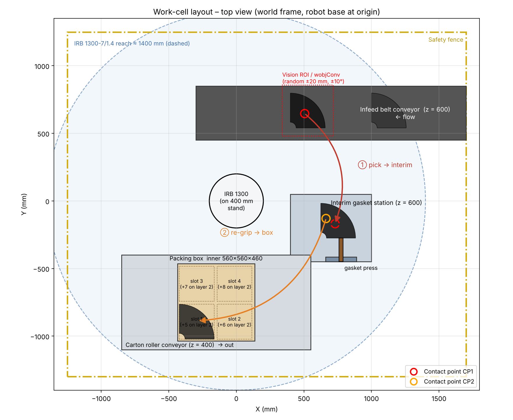
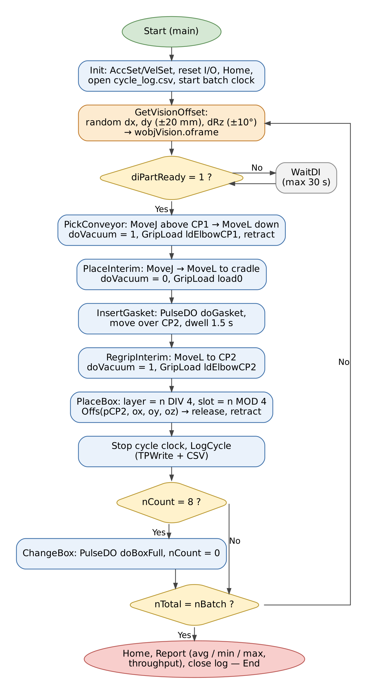

# Elbow-Pipe Robotic Cell

Simulation of an industrial robotic work-cell in which an **ABB IRB 1300** with a vacuum suction gripper
picks moulded elbow pipes from a conveyor, places them on an interim station for gasket insertion,
re-grips them at a second contact point and packs them into a carton in an indexed 2 × 2 × 2 pattern.
Built for ABB RobotStudio.



## Contents

| Folder | What's inside |
|---|---|
| `cad/` | STL models (mm): elbow pipe (OD 215 / ID 185, bend R 150), gasket, interim station, packing box, vacuum gripper, carton conveyor, robot stand |
| `rapid/` | `ElbowPickPlace.mod` – RAPID module: simulated vision offset, two-stage pick-and-place, box indexing, cycle-time logging |
| `docs/` | Project report (.docx) and RobotStudio station build guide (Chinese) |
| `figures/` | Model renders, top-view layout, workflow diagram, program flowchart, cycle-time estimate |
| `scripts/` | Generators for the CAD models, figures, cycle estimate and report |

## Cycle

1. Pick elbow from infeed conveyor at contact point CP1 (vision-corrected `wobjVision`)
2. Place on interim station; gasket press inserts the gasket
3. Re-grip at contact point CP2
4. Place in carton slot *n* (layer = n DIV 4, slot = n MOD 4); index carton after 8 parts

Estimated cycle ≈ 10.5 s/part (≈ 344 parts/h) before simulation – see `figures/cycle_estimate.csv`.



## Regenerating

```bash
python3 scripts/make_models.py cad          # STL models
python3 scripts/render.py cad figures       # model renders
python3 scripts/layout2d.py figures/fig_layout_top.png
python3 scripts/cycle_estimate.py figures/cycle_estimate.csv
dot -Tpng scripts/program_flow.dot -o figures/fig_program_flow.png
```

## Status

- [x] CAD models, RAPID program, diagrams, report draft
- [ ] RobotStudio station (Smart Components, I/O), simulation run, Pack & Go
- [ ] Measured cycle time and screenshots in the report
