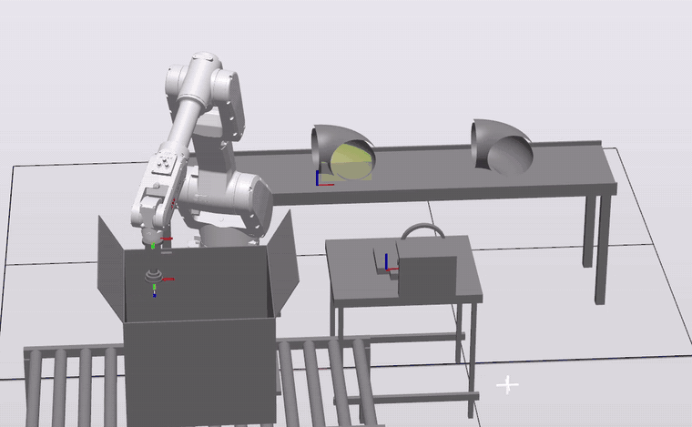
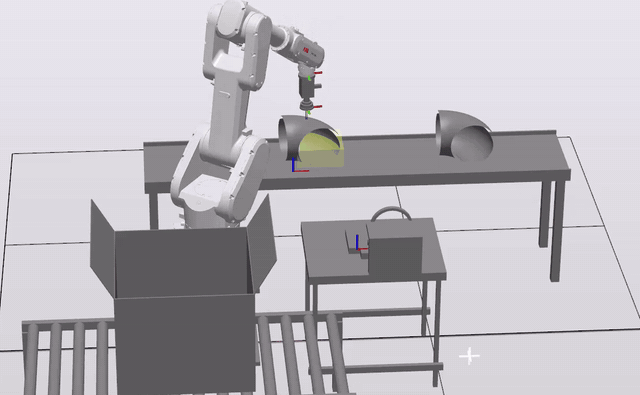
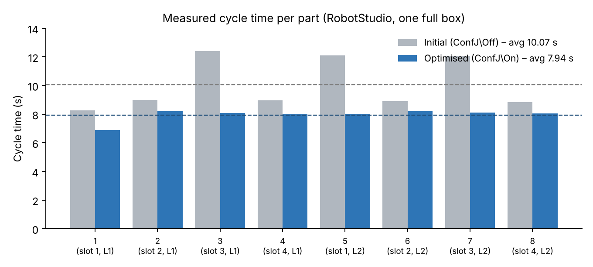
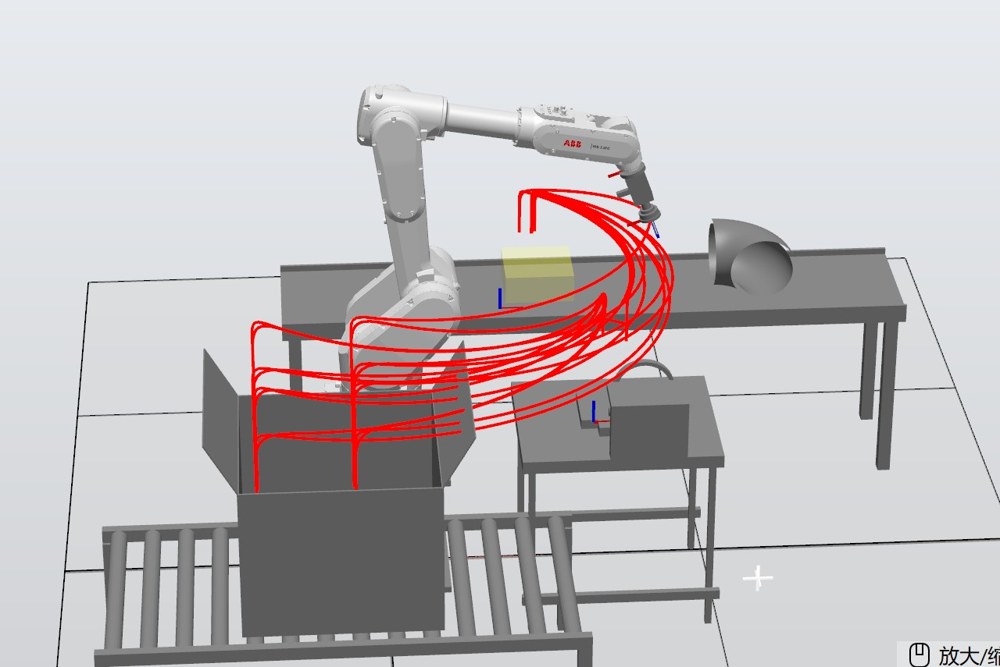
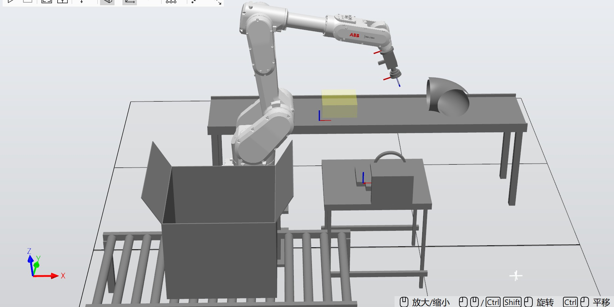
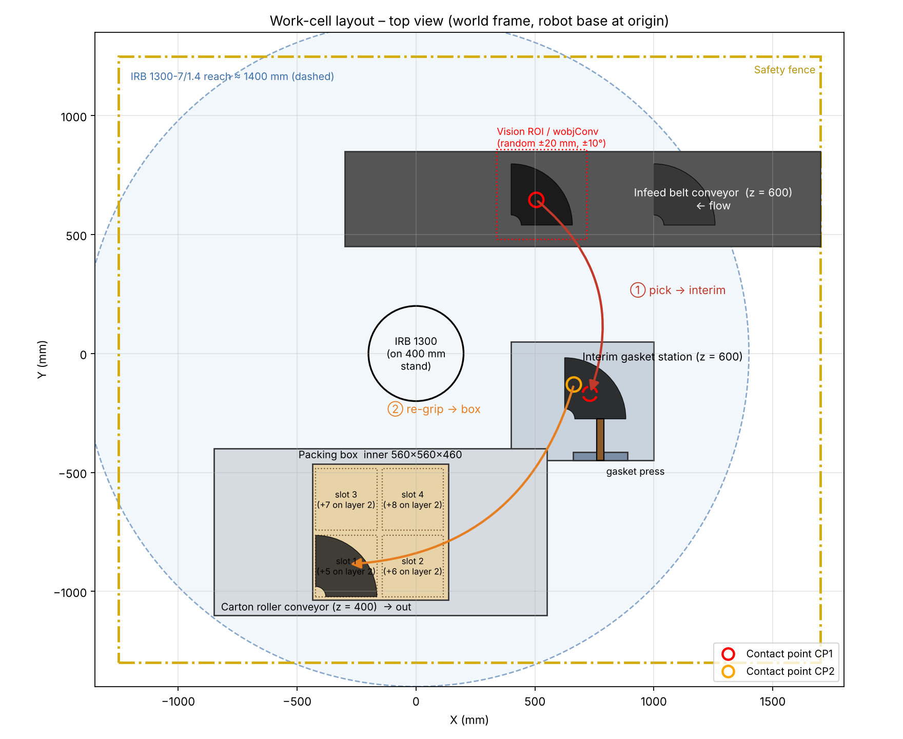
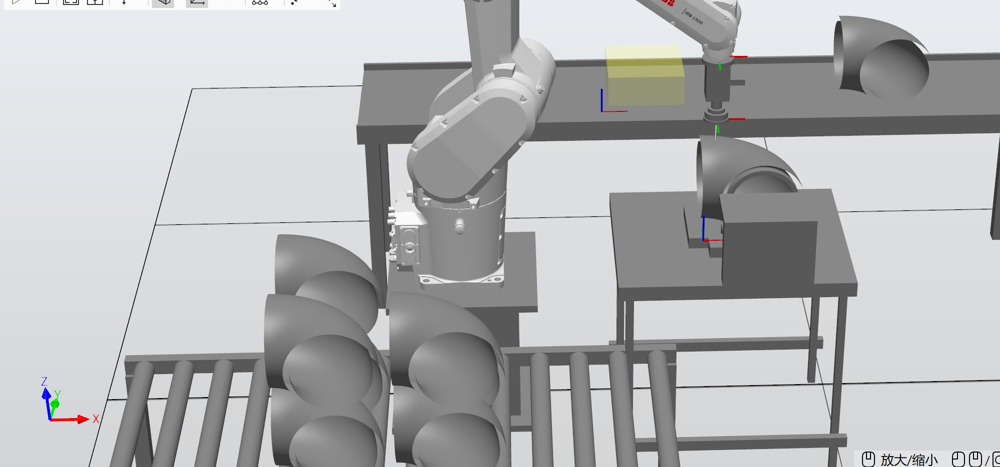
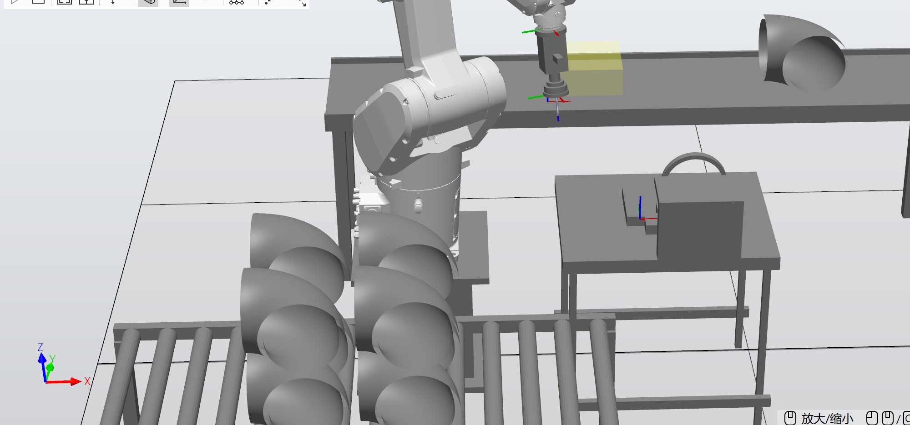
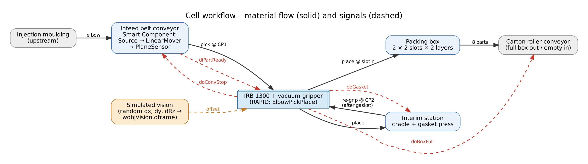
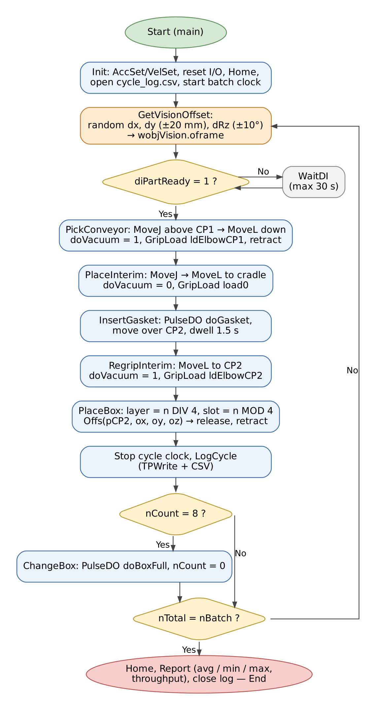

<div align="center">

# 🤖 Elbow-Pipe Robotic Cell

**Vision-guided two-stage pick-and-place with gasket insertion and box packing, built on an ABB IRB 1300 in RobotStudio**




<sub>One complete cycle in real time: pick at CP1 → place on the gasket station → re-grip at CP2 → pack into the box</sub>

</div>

---

## Contents

- [Overview](#overview)
- [The cycle](#the-cycle)
- [Results](#results)
- [Cell layout](#cell-layout)
- [Smart Components & I/O](#smart-components--io)
- [Program design](#program-design)
- [Repository structure](#repository-structure)
- [Getting started](#getting-started)

## Overview

Moulded 90° elbow pipes (Ø215 mm OD, 15 mm wall, 2.5 kg) arrive on an infeed conveyor in slightly varying poses.
An **ABB IRB 1300** with a single-cup **vacuum gripper** picks each pipe, places it on an interim station where a rubber gasket is pressed in, re-grips it at a second contact point, and packs it into a carton in an indexed **2 × 2 × 2** pattern.

| | |
|---|---|
| **Robot** | IRB 1300-7/1.4 on a 400 mm stand |
| **Controller** | OmniCore E10 virtual controller, RobotWare 8.2.2 |
| **End effector** | Vacuum gripper, 1.2 kg, TCP 175 mm from flange |
| **Vision** | Simulated camera: 4 part poses (±18 mm, ±9°) written to `wobjVision.oframe` |
| **Packing** | 8 parts per box (2 × 2 slots, 2 layers) |

## The cycle

| # | Step | RAPID routine | Key detail |
|:-:|---|---|---|
| 1 | Vision result → spawn part | `GetVisionOffset` | Random pose 1–4, pulses `doFeed1…4`, shifts `wobjVision` |
| 2 | Pick from conveyor | `PickConveyor` | Waits for `diPartReady`; MoveL approach to CP1, `doVacuum = 1` |
| 3 | Place on interim station | `PlaceInterim` | Part placed square to the fixture (vision yaw removed) |
| 4 | Gasket insertion | `InsertGasket` | 1.5 s dwell, robot already moves above CP2 |
| 5 | Re-grip | `RegripInterim` | Second contact point CP2, new `GripLoad` |
| 6 | Pack into box | `PlaceBox` | Slot = n MOD 4, layer = n DIV 4 |
| 7 | Log & index | `LogCycle` / `ChangeBox` | Cycle time to `cycle_log.csv`, `doBoxFull` after 8 parts |

<div align="center">

<br><sub>A full box of 8 parts at 4× speed</sub>
</div>

## Results

Measured inside the controller with `ClkStart` / `ClkRead` over one full box:

| | Initial run (`ConfJ\Off`) | Optimised run (`ConfJ\On`) | Change |
|---|:-:|:-:|:-:|
| Average cycle | 10.07 s | **7.94 s** | −21 % |
| Min / max | 8.28 / 12.40 s | 6.88 / 8.21 s | |
| Throughput | 358 parts/h | **453 parts/h** | +27 % |
| Failed picks/places | 0 | 0 | |

<div align="center">

</div>

**What was optimised.** In the first run the joint log (`results/joint_log`) showed the controller alternating between a normal arm configuration and an over-the-head one (axis 1 ≈ −98° vs +60°), which produced large loops and 12 s cycles.
The fix copies the `confdata` of reference joint poses (`CalcRobT`) into every station target and turns configuration monitoring on. After the fix every cycle uses the same compact path:

<div align="center">

<br><sub>TCP trace of 8 cycles after optimisation, with work-object frames</sub>
</div>

## Cell layout

<table>
<tr>
<td width="50%"></td>
<td width="50%"></td>
</tr>
<tr>
<td align="center"><sub>RobotStudio station</sub></td>
<td align="center"><sub>Top view with contact points and transfer paths</sub></td>
</tr>
<tr>
<td></td>
<td></td>
</tr>
<tr>
<td align="center"><sub>Re-grip at the interim station (box hidden)</sub></td>
<td align="center"><sub>Two layers packed in the 2 × 2 pattern (box hidden)</sub></td>
</tr>
</table>

| Work object | Position (mm) | Purpose |
|---|---|---|
| `wobjVision` | (400, 540, 600) | Pick zone; `oframe` = camera offset |
| `wobjInterim` | (625, −275, 630) | Gasket station cradle |
| `wobjBox` | (−150, −750, 406) | Inner floor of the carton |

## Smart Components & I/O

<details>
<summary><b>SC_Gripper</b>: vacuum gripper logic</summary>

| Component | Setting |
|---|---|
| LineSensor | Cup axis, 160–235 mm from flange, r = 3 mm, active when `diVacuum = 1` |
| Attacher | Parent `tVacuum`, Mount = false, triggered by `SensorOut` |
| LogicGate NOT → Detacher | Releases the part when `diVacuum = 0`, KeepPosition = true |
| Bindings | `SensedPart → Attacher.Child → Detacher.Child` |
</details>

<details>
<summary><b>SC_Infeed</b>: simulated vision-guided infeed</summary>

| Component | Setting |
|---|---|
| Source … Source_4 | One per part pose, Transient = true, triggered by `diFeed1…4` |
| VolumeSensor | 220 × 220 × 90 mm over the pick zone, sets `doPartReady` |
</details>

| Controller signal | Dir | Station Logic connection |
|---|:-:|---|
| `doFeed1…4` | out | → `SC_Infeed.diFeed1…4` |
| `diPartReady` | in | ← `SC_Infeed.doPartReady` |
| `doVacuum` | out | → `SC_Gripper.diVacuum` |
| `doGasket`, `doBoxFull`, `doConvStop` | out | reserved for the real peripherals |

## Program design

<table>
<tr>
<td width="55%"></td>
<td width="45%" rowspan="2"></td>
</tr>
<tr><td>

- **MoveJ** between zones at 2000 mm/s with large zones
- **MoveL** for the last 150 mm of every approach; final 10–30 mm at 150 mm/s, `fine`
- **GripLoad** with separate load data for CP1 and CP2 (different CoG offsets)
- **ConfJ\On / ConfL\On** with `confdata` from reference joint poses
- Every pick/place logs joint angles to `joint_log.csv` for configuration analysis

</td></tr>
</table>

## Repository structure

```
elbow-pipe-robotic-cell/
├── cad/                 STL models (mm) + cell_assembly.stl
│   └── catia/           CATIA V5 macro that rebuilds every part as CATPart/STEP
├── rapid/               ElbowPickPlace.mod + EIO_*.cfg (I/O signals)
├── results/             cycle_log_*.csv, joint_log_optimised.csv
├── media/               GIFs of the simulation
├── figures/             Screenshots, layout, workflow and flowchart
├── docs/                Project report (.docx), setup guide & dimension checklist (中文)
└── scripts/             Generators for models, figures, cycle estimate and report
```

## Getting started

1. Install **RobotStudio** and **RobotWare 8.2.2 for OmniCore** (Add-Ins → RobotApps).
2. Open the Pack & Go file `MA6212_ElbowCell.rspag` (submitted separately, 72 MB) via *File → Share → Unpack & Work*.
3. *Simulation → Play*. Cycle times are written to `HOME:/cycle_log.csv` of the virtual controller.

> **Note:** If your Windows user name contains non-ASCII characters, set *Options → Files & Folders → Virtual controller install location* to an ASCII path (e.g. `D:\ABB\RobotWare`) before creating or unpacking the controller.

To regenerate the models and figures:

```bash
python3 scripts/make_models.py cad                 # STL models
python3 scripts/make_assembly.py cad cad/cell_assembly.stl
python3 scripts/layout2d.py figures/fig_layout_top.png
dot -Tpng scripts/program_flow.dot -o figures/fig_program_flow.png
```

---

<div align="center"><sub>MA6212 Robotic Manipulation & Advanced Control · Group Project · NTU</sub></div>
